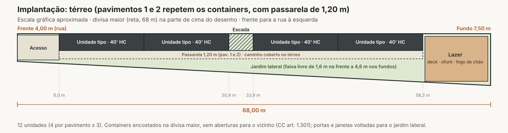

# Estudo de viabilidade: multipropriedade em containers

Terreno de 391 m² (frente 4 m, fundo 7,5 m, divisa maior de 68 m) · 3 pavimentos · 12 unidades · Camanducaia/MG

> Estudo preliminar para decisão de "seguir ou não seguir". Custos e preços são estimativas de mercado (out/2026) e precisam ser validados com orçamentos, consulta à prefeitura e pesquisa de preço local antes de qualquer compromisso.

**Arquivos deste estudo**

| Arquivo | O que é |
|---|---|
| `video/apresentacao-3d.mp4` | Vídeo 3D de apresentação (60 s, 1080p) |
| `modelo/apresentacao-3d.html` | Modelo 3D interativo (abre no navegador; botão "Explorar livre" para girar e dar zoom) |
| `planta-implantacao.svg` | Planta de implantação do térreo |
| `dados/viabilidade.py` | Modelo financeiro (todas as contas deste documento) |
| `dados/resultado.txt` | Saída do modelo financeiro |
| `modelo/render-video.mjs` | Script que gera o vídeo a partir do modelo 3D |

---

## 1. Resumo executivo

**Veredito: viável com ressalvas. Fisicamente o projeto cabe bem; financeiramente, a margem é apertada no cenário base e o gargalo real é o caixa.**

| Indicador | Valor |
|---|---|
| Unidades | 12 studios em containers 40' HC (≈ 28 m² úteis cada) |
| Cotas | 156 (13 por unidade, 4 semanas/ano cada) |
| Investimento total de obra (chave na mão, com 10% de contingência) | **R$ 2,80 mi** (R$ 233 mil por unidade) |
| VGV no cenário base (R$ 36.900 por cota) | **R$ 5,76 mi** |
| Lucro no cenário base (90% vendido) | **R$ 525 mil** (margem de 10% sobre a receita) |
| Ponto de equilíbrio | 120 de 156 cotas vendidas a R$ 36.900, ou preço mínimo de R$ 28.300 com 100% vendido |
| Exposição máxima de caixa | **≈ R$ 2,3 a 2,7 mi** (o dinheiro das vendas entra parcelado, a obra é paga à vista) |
| Retorno do caixa investido | entre o mês 34 e o mês 44 |

**O que decide o projeto (em ordem):**

1. **Preço da cota.** Abaixo de R$ 35 mil o projeto não para de pé. Para margem saudável (20%), a cota precisa sair por **≈ R$ 44 mil**. Isso tem que ser testado no mercado antes de investir.
2. **Funding.** Multipropriedade é vendida parcelada. Sem capital próprio ou financiamento de ≈ R$ 2,5 mi, não há obra. Construir em fases reduz a exposição pela metade.
3. **Aprovação na prefeitura.** Coeficiente de aproveitamento (CA 1,28), gabarito de 3 pavimentos, construção encostada na divisa e vagas de garagem precisam ser confirmados na lei de uso do solo de Camanducaia.

**Recomendação:** não comprar containers ainda. Rodar a validação de 60 dias (seção 10) com pré-venda de cotas. Se 30 cotas (≈ 20%) forem reservadas com sinal a ≥ R$ 39.900, seguir com a Fase 1.

---

## 2. Terreno e premissas de leitura do croqui

| Item | Valor |
|---|---|
| Frente (testada menor) | 4,00 m |
| Fundo | 7,50 m |
| Divisa maior (reta, perpendicular à frente e ao fundo) | 68,00 m |
| Área | (4 + 7,5) / 2 × 68 = **391 m²** |
| Largura do lote em qualquer ponto | 4 + 3,5 × (distância da frente / 68) |

Premissas assumidas (confirmar):

- A rua está no lado de **4 m**. Se a rua for no lado de 7,5 m, o projeto apenas se espelha: o lazer vai para a frente e o acesso para o fundo.
- Terreno plano. Declive muda fundação e custo.
- Terreno já pertence ao empreendedor. Entra no estudo como custo de oportunidade de R$ 250 mil.
- Localização: Camanducaia/MG, com apelo turístico de Monte Verde e da Serra da Mantiqueira.

---

## 3. Proposta arquitetônica

### 3.1 Partido

- **Containers 40' High Cube** (12,19 × 2,44 × 2,90 m) encostados na divisa maior, em fila, 3 pavimentos.
- **2 blocos** de 2 containers por pavimento, separados por um **núcleo de escada central** (3,5 m).
- **Passarela lateral de 1,20 m** nos pavimentos 1 e 2, voltada para o jardim. No térreo, a projeção da passarela vira caminho coberto.
- **Cobertura termoacústica única** sobre todo o conjunto, com testeira de madeira e **≈ 20 kWp de energia solar**.
- **Fachada com brises de madeira** nos guarda-corpos (privacidade e conforto térmico).
- **Lazer nos fundos**, onde o lote alarga: deck, ofurô aquecido, fogo de chão e espreguiçadeiras.

| Faixa do lote (a partir da frente) | Uso |
|---|---|
| 0 a 6,0 m | Acesso, portão, lixeiras, medidores, bicicletário |
| 6,0 a 30,4 m | Bloco A: 2 containers por pavimento |
| 30,4 a 33,9 m | Núcleo de escada |
| 33,9 a 58,3 m | Bloco B: 2 containers por pavimento |
| 58,3 a 68,0 m | Lazer (≈ 70 m²) |

### 3.2 Quadro de áreas

| Item | Área |
|---|---|
| Área por unidade (externa) | 29,7 m² (≈ 28 m² úteis) |
| Área das 12 unidades | 357 m² |
| Passarelas (2 pavimentos) | 117 m² |
| Escada (3 níveis) | 26 m² |
| **Área construída total** | **≈ 500 m²** |
| Projeção no terreno | ≈ 186 m² |
| Taxa de ocupação | **48%** |
| Coeficiente de aproveitamento | **1,28** |
| Altura total | ≈ 9,5 m |

### 3.3 Unidade tipo (≈ 28 m², até 4 pessoas)

Banheiro completo · kitchenette com frigobar, cooktop e mesa para 2 · estar com sofá-cama · quarto com cama queen e armário · porta de vidro e janelas voltadas para o jardim, nenhuma abertura para o vizinho.

### 3.4 Pontos técnicos que precisam de solução no projeto

| Ponto | Solução proposta |
|---|---|
| Calor e frio (aço conduz muito) | Isolamento em PU ou lã de rocha nas paredes e no teto, cobertura ventilada separada do container, vidro com controle solar. Em Monte Verde o frio pesa mais: prever aquecimento. |
| Cortes para portas e janelas enfraquecem o container | Reforço com perfis metálicos em todo vão. Exige projeto estrutural com ART. |
| Empilhamento de 3 níveis | Containers suportam bem nos cantos. Fundação em blocos sob os 4 cantos de cada coluna. |
| Ruído entre unidades | Forro e piso com manta acústica; containers do mesmo pavimento separados por junta. |
| Privacidade na passarela | Todos passam em frente às portas de vidro dos pavimentos superiores. Usar película, cortinas blackout e brises. |
| Janelas a menos de 1,5 m do vizinho (CC art. 1.301) | Nenhuma abertura na divisa maior. No trecho estreito da frente, a passarela fica a menos de 1,5 m da divisa oposta: usar brise opaco de 1,80 m nesse trecho. |
| Segurança contra incêndio | Escada única atende o porte, mas o projeto precisa ser aprovado no Corpo de Bombeiros de MG. |
| Acessibilidade | As 4 unidades do térreo podem ser adaptadas (NBR 9050). |

---

## 4. Produto de multipropriedade

### 4.1 Estrutura do produto

| Item | Proposta |
|---|---|
| Base legal | Lei 13.777/2018 (multipropriedade) + incorporação imobiliária (Lei 4.591/64) com patrimônio de afetação |
| Cotas por unidade | 13 cotas de 4 semanas por ano (52 semanas) |
| Total de cotas | 156 |
| Uso | 1 semana por trimestre, em calendário rotativo para dividir alta temporada (inverno) de forma justa |
| Preço base | R$ 36.900 por cota |
| Condições sugeridas | 20% de entrada + saldo em até 36 parcelas |
| Taxa anual de manutenção | ≈ R$ 1.800 por cota (limpeza, enxoval, IPTU, manutenção, fundo de reserva) |

### 4.2 Vantagem estratégica: a pousada como operadora

A Pousada Engenho do Vô já tem marca, recepção, equipe e clientes na cidade. Isso resolve três problemas que derrubam projetos de multipropriedade pequenos:

1. **Gestão:** a pousada administra o condomínio e recebe taxa de administração (≈ R$ 56 mil/ano com 20% sobre R$ 281 mil de taxas de manutenção).
2. **Pool de locação:** semanas não usadas pelos cotistas são alugadas pela pousada, com divisão de receita. Isso aumenta o valor percebido da cota.
3. **Venda:** a base de hóspedes atual é o primeiro público a ser ofertado (custo de aquisição muito menor que tráfego pago frio).

---

## 5. Custos de implantação

| Item | Valor |
|---|---|
| Containers 40' HC (12 × R$ 22 mil) | R$ 264.000 |
| Conversão completa (estrutura, isolamento, instalações, acabamento) 12 × R$ 88 mil | R$ 1.056.000 |
| Mobiliário e enxoval padrão hoteleiro 12 × R$ 25 mil | R$ 300.000 |
| Escada metálica, passarelas, guarda-corpos e brises | R$ 235.000 |
| Área de lazer (deck, ofurô, fogo de chão, paisagismo) | R$ 150.000 |
| Infraestrutura (água, esgoto, entrada elétrica, SPDA, PPCI) | R$ 120.000 |
| Projetos, aprovações, incorporação, registro e jurídico | R$ 120.000 |
| Fundações | R$ 90.000 |
| Energia solar (≈ 20 kWp) | R$ 80.000 |
| Cobertura termoacústica, calhas e drenagem | R$ 70.000 |
| Transporte e içamento com guindaste | R$ 60.000 |
| **Subtotal** | **R$ 2.545.000** |
| Contingência (10%) | R$ 254.500 |
| **Total de obra** | **R$ 2.799.500** |
| Terreno (custo de oportunidade) | R$ 250.000 |
| **Investimento total considerado** | **R$ 3.049.500** |

Ponto de atenção: o custo por unidade (R$ 233 mil) parece alto para "container", mas inclui a parte que ninguém coloca no anúncio de container pronto: escada, passarelas, cobertura, lazer, mobília hoteleira, legalização e incorporação.

---

## 6. Receitas e cenários

Deduções aplicadas sobre a receita: comissão e marketing 20% (vendas de multipropriedade são intensivas em marketing), impostos 4% (RET com patrimônio de afetação), distratos e inadimplência 5%, administração de vendas 2%. Total: 31%.

| Cenário | Preço da cota | % vendido | Receita | Custo total | **Lucro** | Margem | ROI |
|---|---|---|---|---|---|---|---|
| Pessimista (custo +15%) | R$ 29.900 | 80% | R$ 3,73 mi | R$ 3,47 mi | **R$ -895 mil** | -24% | -26% |
| **Base** | R$ 36.900 | 90% | R$ 5,18 mi | R$ 3,05 mi | **R$ 525 mil** | 10% | 17% |
| Otimista (custo -5%) | R$ 44.900 | 100% | R$ 7,00 mi | R$ 2,91 mi | **R$ 1,92 mi** | 27% | 66% |

### Sensibilidade do lucro (R$ mil, custo base)

| Preço da cota \ % vendido | 70% | 80% | 90% | 100% |
|---|---|---|---|---|
| R$ 29.900 | -797 | -475 | -153 | 169 |
| R$ 34.900 | -420 | -44 | 331 | 707 |
| R$ 39.900 | -43 | 386 | **816** | 1.245 |
| R$ 44.900 | 334 | 817 | **1.300** | 1.784 |
| R$ 49.900 | 710 | 1.247 | 1.785 | 2.322 |

Leitura: **cada R$ 5 mil no preço da cota vale ≈ R$ 485 mil de lucro**. O preço pesa mais que a velocidade de venda. Por isso a validação de preço é o primeiro passo.

---

## 7. Fluxo de caixa: o verdadeiro gargalo

Premissas: vendas de 90% das cotas ao longo de 24 meses, 20% de entrada e saldo em 36 parcelas, comissão paga na venda, obra de 10 meses.

| Estratégia | Exposição máxima de caixa | Caixa volta a zero |
|---|---|---|
| Base (20% entrada + 36x, obra no mês 3) | R$ 2,65 mi | mês 44 |
| Entrada de 30% + 24x | R$ 2,40 mi | mês 34 |
| Pré-venda por 7 meses antes de iniciar a obra | R$ 2,30 mi | mês 42 |

A comissão consome praticamente toda a entrada. Na prática, **a obra é paga com capital próprio ou financiamento**, e o lucro só aparece no caixa a partir do 3º ou 4º ano.

**Como reduzir a exposição:**

1. **Construir em 2 fases.** Fase 1: Bloco B (6 unidades) + escada + lazer, ≈ R$ 1,5 a 1,6 mi. Fase 2 (Bloco A) só depois de vender 60% das cotas da Fase 1.
2. **Antecipação de recebíveis:** a carteira de parcelas das cotas pode ser descontada em securitizadora ou fintech de crédito imobiliário (custo de 1,2% a 1,8% ao mês).
3. **Entrada maior com desconto:** oferecer 5% a 8% de desconto para pagamento com 50% de entrada.
4. **Sócio investidor** entrando com o capital da obra e remunerado na carteira de recebíveis.

---

## 8. Comparativo de modelos

| Modelo | Retorno | Risco | Quando faz sentido |
|---|---|---|---|
| **Multipropriedade (100%)** | Lucro de R$ 0,5 a 1,9 mi em 3 a 4 anos + taxa de gestão recorrente | Alto: depende de preço e velocidade de venda | Se a pré-venda provar demanda a ≥ R$ 40 mil por cota |
| **Pousada própria (sem vender)** | ≈ R$ 320 mil/ano de lucro operacional (diária R$ 380, ocupação 55%, margem 35%); payback ≈ 9,5 anos | Médio: risco operacional, sem risco de venda | Se houver capital paciente e a pousada já opera com boa ocupação |
| **Híbrido** (6 unidades em multipropriedade + 6 na pousada) | Venda paga boa parte da obra e a pousada fica com receita recorrente | Médio | **Opção mais equilibrada para o perfil de PME** |

---

## 9. Riscos e mitigação

| Risco | Impacto | Mitigação |
|---|---|---|
| Lei municipal não permitir CA 1,28, 3 pavimentos ou construção na divisa | Inviabiliza o projeto como desenhado | Consulta prévia à prefeitura antes de qualquer gasto. Plano B: 2 pavimentos (8 unidades). |
| Exigência de vagas de garagem | O lote não comporta 12 vagas | Convênio com estacionamento próximo ou uso da estrutura da pousada. Confirmar se a lei aceita. |
| Preço da cota abaixo de R$ 35 mil | Prejuízo | Pré-venda com sinal antes da obra (seção 10). |
| Venda lenta (cidade pequena, produto novo) | Caixa travado | Vender primeiro para a base de hóspedes; fases; canal de corretores especializados em multipropriedade. |
| Obra em container estourar custo | Margem some | Contratar fornecedor de container modular com preço fechado (turnkey) e 10% de contingência. |
| Conforto térmico ruim | Reclamações, desvalorização | Isolamento bem especificado e cobertura ventilada. Visitar um projeto de container na serra antes de contratar. |
| Insegurança jurídica do produto | Distratos e processos | Contrato e convenção feitos por advogado com experiência em Lei 13.777/2018; registro da incorporação antes de vender. |
| Corrosão do aço | Manutenção alta no longo prazo | Pintura epóxi + PU, cobertura que protege o topo dos containers, fundo de reserva. |

---

## 10. Próximos passos: validação de 60 dias (antes de investir)

| # | Ação | Responsável | Prazo | Critério de "seguir" |
|---|---|---|---|---|
| 1 | Consulta prévia na prefeitura (zoneamento, TO, CA, gabarito, recuos, vagas, construção na divisa) | Arquiteto | 15 dias | Projeto aprovável com até 3 pavimentos |
| 2 | Confirmar medidas, orientação e topografia do terreno | Topógrafo | 15 dias | Terreno plano ou com declive leve |
| 3 | 3 orçamentos turnkey de containers modulares (por unidade e conjunto) | Empreendedor | 30 dias | ≤ R$ 120 mil por unidade (container + conversão) |
| 4 | Pesquisa de preço: multipropriedades e chalés em Monte Verde e região | Empreendedor | 20 dias | Cota equivalente ≥ R$ 40 mil |
| 5 | Pré-venda: lista de interesse com a base de hóspedes, usando o vídeo 3D, com sinal reembolsável | Pousada | 45 dias | ≥ 30 reservas com sinal |
| 6 | Definir funding (capital próprio, sócio, antecipação de recebíveis) | Empreendedor | 60 dias | R$ 1,6 mi garantidos para a Fase 1 |
| 7 | Advogado para estrutura de incorporação e multipropriedade | Jurídico | 60 dias | Minuta de convenção e contrato |

**Regra de decisão:** itens 1, 4 e 5 aprovados = seguir com a Fase 1. Qualquer um reprovado = reavaliar como pousada própria ou modelo híbrido.

---

## 11. Como abrir e reproduzir

- **Vídeo:** `video/apresentacao-3d.mp4`.
- **Modelo 3D interativo:** abra `modelo/apresentacao-3d.html` no navegador (precisa de internet para carregar a biblioteca 3D). A linha do tempo roda sozinha; "Explorar livre" libera o giro e o zoom com o mouse.
- **Modelo financeiro:** `python3 dados/viabilidade.py`. Altere as premissas no topo do arquivo para simular outros cenários.
- **Gerar o vídeo de novo:** em uma pasta com `three@0.160.0` e `playwright` instalados, rode `HTML=<caminho>/apresentacao-3d.html node render-video.mjs saida.mp4 30 0 60 4`.
